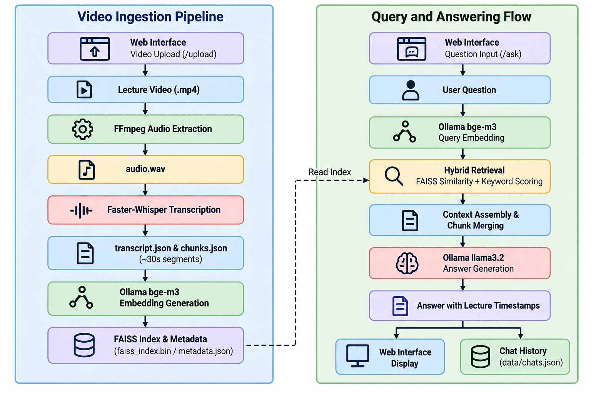

<p align="center">
  <h1 align="center">LectureLens AI</h1>
  <p align="center">
    <strong>Search inside lecture videos using natural-language questions and receive answers with relevant lecture timestamps.</strong>
  </p>
  <p align="center">
    
    
    
  </p>
</p>

## Project Overview

While watching a YouTube HTML course playlist containing around 15 videos, I realized that finding a specific topic across multiple recordings could be time-consuming. Even though each video had its own title and thumbnail, I still had to search through several videos to find the exact explanation I needed. This inspired me to build a system where students could ask questions and quickly find the relevant video and timestamp.

**LectureLens AI is a Retrieval-Augmented Learning Assistant** that helps students search and understand locally stored lecture videos through natural-language questions. It retrieves relevant lecture segments and generates answers with source references and timestamps, allowing students to navigate directly to the corresponding point in a video.

The AI pipeline uses **FFmpeg** for audio extraction, **Faster-Whisper** for timestamped transcription, **BGE-M3** for generating text embeddings, and **FAISS** for retrieving relevant lecture segments. The retrieved context is validated before being passed to **Llama 3.2 through Ollama** to generate answers grounded in the available lecture content.

Alongside the AI pipeline, I developed a **Flask-based web application** with HTML, CSS, and JavaScript. It allows students to organize courses and lectures, play videos, browse transcripts, and interact with an AI chat. Answers include clickable source references that navigate to the relevant video timestamps.

A key objective was to keep the core AI processing local, without sending lecture content to external AI services. The current implementation focuses on lecture videos, while support for documents and additional study tools remains part of future development.

## Key Features

- **Course and Lecture Organization:** Organize multiple courses with dedicated video libraries, lecture registries, and separate chat sessions.
- **Video Processing Pipeline:** Upload MP4 lecture videos through the web interface and process them through audio extraction, transcription, chunking, embedding generation, and FAISS indexing.
- **Timestamped Transcription:** Convert lecture audio into text using Faster-Whisper, preserving timestamps and organizing transcripts into approximately 30-second chunks.
- **Hybrid Retrieval:** Combine FAISS-based semantic similarity search with keyword matching and domain-specific synonym handling to retrieve relevant lecture segments.
- **Context-Aware Answer Generation:** Use Llama 3.2 through Ollama to generate answers grounded in retrieved lecture content, with relevant source references and timestamps.
- **Context Validation:** Validate retrieved segments using query keywords and technical synonyms to help identify unsupported questions and reduce irrelevant context.
- **Interactive Learning Workspace:** Provide a Flask-based web interface with video playback controls, transcript access, and AI chat.
- **Clickable Source Navigation:** Allow students to open the relevant lecture video directly at the timestamp associated with a retrieved source.
- **Local AI Processing:** Run speech transcription, embedding generation, and answer generation locally using Faster-Whisper and Ollama, without sending lecture content to external AI services.

## Project Architecture

<p align="center">
  
</p>

## Technologies Used

### Backend and Media Processing

- **Python 3.10+:** Core programming language.
- **Flask:** Web application framework and REST API endpoints.
- **FFmpeg:** System utility for extracting audio tracks from MP4 videos.
- **Faster-Whisper (`large-v2`):** Local automatic speech recognition (ASR) engine.
- **FAISS (`faiss-cpu`):** Vector similarity search library using inner-product search on normalized embeddings.
- **NumPy and Pandas:** Numerical operations, vector normalization, and tabular data manipulation.
- **Requests:** HTTP client communicating with local Ollama service endpoints.

### Local AI Models

- **BGE-M3 (via Ollama):** 1024-dimensional dense semantic embedding model for transcript chunks and search queries.
- **Llama 3.2 (via Ollama):** Local large language model used for prompt-grounded question answering.

### Frontend

- **HTML5, CSS3, JavaScript (Vanilla):** Web interface and client-side interactions.
- **Tailwind CSS:** Utility classes loaded through a CDN for interface styling.

## Project Structure

```text
LectureLens-AI/
├── app.py                  # Flask application entry point and REST API routes
├── pipeline/               # Standalone batch processing scripts
│   ├── video_to_audio.py   # Extracts audio.wav from video.mp4 using FFmpeg
│   ├── audio_to_json.py    # Transcribes audio to transcript.json and chunks.json
│   ├── chunk_to_embeddings.py # Generates embeddings and builds FAISS index
│   ├── run_pipeline.py     # Orchestrator running the complete pipeline
│   └── README.md           # Documentation for the processing pipeline
├── src/                    # Core application backend modules
│   ├── course_registry.py  # Course creation, lookup, and metadata storage
│   ├── lecture_registry.py # Lecture state tracking and disk synchronization
│   ├── chat_registry.py    # Chat session storage and message history
│   ├── upload_pipeline.py  # Web upload handling, transcription, and indexing
│   ├── rag_engine.py       # Hybrid retrieval and LLM answer generation
│   └── README.md           # Documentation for backend modules
├── static/                 # Frontend assets
│   ├── css/style.css       # Application stylesheets
│   └── js/                 # Client-side scripts (home.js, workspace.js)
├── templates/              # Jinja2 HTML templates
│   ├── home.html           # Course selection and management interface
│   └── index.html          # Workspace interface with video player and chat
├── requirements.txt        # Python package dependencies
├── .gitignore              # Git ignore rules for virtual envs, data, and indexes
└── README.md               # Main project documentation
```

## Installation and Setup

### Prerequisites
- Python 3.10 or higher
- Git
- Internet connection (for initial package and model downloads)
- FFmpeg installed and available in your system `PATH`
- [Ollama](https://ollama.com/) installed and running locally

### 1. Clone the Repository
```bash
git clone https://github.com/darshanbg23/LectureLens-AI.git
cd LectureLens-AI
```

### 2. Set Up a Virtual Environment

On Windows:
```bash
python -m venv venv
venv\Scripts\activate
```

On macOS and Linux:
```bash
python3 -m venv venv
source venv/bin/activate
```

### 3. Install Python Dependencies
```bash
pip install -r requirements.txt
```

### 4. Verify FFmpeg Installation
Ensure FFmpeg is installed and accessible from your terminal:
```bash
ffmpeg -version
```
If not installed:
- Windows: Install via `winget install Gyan.FFmpeg` or download from [ffmpeg.org](https://ffmpeg.org/download.html) and add the `bin` directory to your system `PATH`.
- macOS: Install via Homebrew: `brew install ffmpeg`
- Linux (Ubuntu/Debian): Install via `sudo apt update && sudo apt install -y ffmpeg`

### 5. Download Required Ollama Models
Start the Ollama service, then pull the embedding and language models:
```bash
ollama pull bge-m3
ollama pull llama3.2
```

### 6. Run the Application
Start the Flask development server from the project root:
```bash
python app.py
```
Open your browser and navigate to:
```text
http://localhost:5000
```

> Note: When you upload lecture videos through the web interface, audio extraction, transcription, and indexing run automatically in the background. The manual batch pipeline (`python pipeline/run_pipeline.py`) is optional and only needed if you wish to pre-process multiple lecture folders directly from the filesystem without using the web upload interface.

## Usage

1. Create a Course: On the home page (`/`), click "Create New Course", enter a course title and instructor name, and submit.
2. Open the Workspace: Click on the course card to enter its workspace (`/workspace/<course_id>`).
3. Upload Lectures: In the Materials sidebar, click "Add Material" or the upload button, select an MP4 video file, and confirm.
4. Background Processing: The upload panel tracks progress across audio extraction, transcription, chunking, and FAISS indexing.
5. Watch and Study: Once indexing completes, select a lecture to watch the video and inspect the transcript.
6. Ask Questions: In the AI Assistant panel, enter questions regarding the lecture material. The assistant returns answers citing the relevant lecture number and timestamp range.

### Example Questions
- "Where is the video tag explained?"
- "What is the difference between semantic and non-semantic elements?"
- "Which lecture discusses responsive layouts and flexbox?"
- "Summarize the key points covered in Lecture 2."


## Current Limitations

- **Processing Time:** Transcription, embedding generation, and indexing take time. On the current setup, processing a one-minute video takes approximately 1–1.5 minutes. Actual performance depends on system resources and model configuration.
- **Limited File Support:** The current system supports MP4 lecture videos. PDFs, PowerPoint presentations, Word documents, and other document formats are not yet supported.
- **Sequential Processing:** Video processing handles one job at a time. Additional processing requests are rejected while another video is being processed.
- **Hardware Requirements:** Running Faster-Whisper and local Ollama models requires sufficient memory and processing power. CPU-based processing can be slow for longer videos.
- **Local Service Dependency:** Embedding generation and answer generation depend on Ollama running locally with the required models available.
- **Transcription Errors:** Background noise, unclear speech, and technical terminology can affect transcription quality and subsequent retrieval.
- **Retrieval Limitations:** Answer quality depends on retrieving relevant lecture content. Missing or incorrect context can lead to incomplete answers or inappropriate refusals.
- **No Note-Making Functionality:** The notes tab is currently a placeholder and does not support creating, editing, or saving notes.

## Future Improvements

- **Document Support:** Add support for PDFs, PowerPoint presentations, Word documents, text files, and Markdown notes alongside lecture videos.
- **Note-Making:** Implement functionality to create, edit, and save notes associated with lectures.
- **Faster Processing:** Optimize transcription, embedding generation, and indexing to reduce processing time.
- **Parallel Processing:** Introduce parallel job execution to handle multiple video uploads more efficiently.
- **Model Optimization:** Support lighter transcription and language models for systems with limited hardware resources.
- **Retrieval Improvements:** Explore reranking and other relevance-enhancement techniques to improve the quality of retrieved lecture segments.
- **Cross-Resource Search:** Enable searches across lecture videos and documents within the same course.
- **Study Material Export:** Add options to export chat conversations, timestamped references, and study notes.
- **Scalable Storage:** Explore a dedicated vector database to manage larger collections of courses and learning resources.

## Detailed Documentation

For technical details on specific components, refer to the following documentation files:

- [Processing Pipeline](pipeline/README.md): Documentation on video-to-audio conversion, transcription, chunking, embedding generation, and FAISS index construction.
- [Backend Modules](src/README.md): Documentation on backend modules, data storage schemas, function references, and component interactions.

## Acknowledgements

- [Faster-Whisper](https://github.com/SYSTRAN/faster-whisper) for high-performance automatic speech recognition.
- [Ollama](https://ollama.com/) for local model serving and execution.
- [BAAI BGE-M3](https://huggingface.co/BAAI/bge-m3) for dense vector text embeddings.
- [Meta Llama 3.2](https://www.llama.com/) for natural language generation.
- [FAISS](https://github.com/facebookresearch/faiss) for efficient vector similarity search.
- [FFmpeg](https://ffmpeg.org/) for media extraction and audio conversion.
- [Flask](https://flask.palletsprojects.com/) for the web server framework.